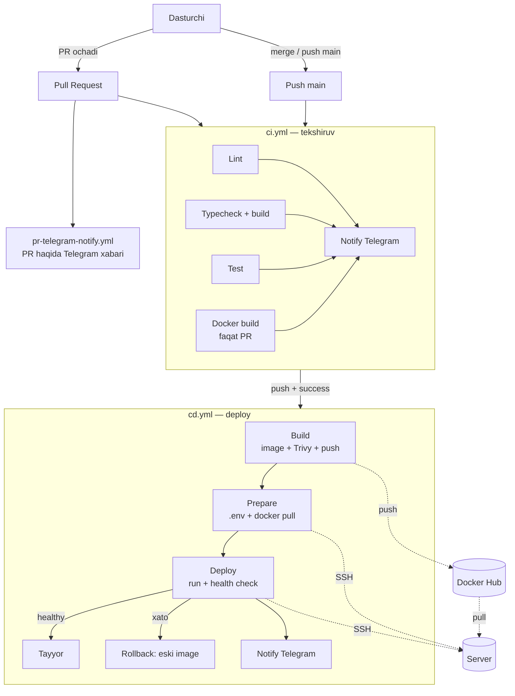

# .github — CI/CD avtomatlashtirish: to'liq qo'llanma

Bu papka loyihaning **barcha avtomatlashtirishini** o'z ichiga oladi: kodni tekshirish (CI), serverga joylashtirish (CD), kutubxonalarni yangilash, PR shabloni va Telegram xabarnomalari.

Maqsad: dasturchi kodni `git push` / PR qilishi bilan **tekshiruv, build, xavfsizlik skaneri, deploy va xabarnoma** hammasi odam aralashuvisiz bajarilsin.

Hujjat ikki qismdan iborat: **I qism** (1-10) umumiy tushuncha, arxitektura va sozlash; **II qism** (11-19) har bir fayl va har bir muhim qatorning tushuntirishi, shunda keyin o'zingiz o'zgartira olasiz.

## Mundarija

**I qism: umumiy**

1. [Imkoniyatlar](#1-imkoniyatlar)
2. [Arxitektura](#2-arxitektura)
3. [Papka tuzilmasi](#3-papka-tuzilmasi)
4. [**Kerakli environment'lar (Variables va Secrets)**](#4-kerakli-environmentlar-variables-va-secrets)
   - [Environment qanday yaratiladi](#environment-qanday-yaratiladi)
   - [4.1 Variables](#41-variables-maxfiy-emas-qiymati-korinadi)
   - [4.2 Secrets](#42-secrets-maxfiy-logda--bolib-chiqadi)
   - [4.3 GitHub o'zi beradigan qiymatlar](#43-kiritish-shart-emas-github-ozi-beradi)
   - [4.4 Qiymatlarni qayerdan olish](#44-qiymatlarni-qayerdan-olish)
   - [4.5 Muhim eslatmalar](#45-muhim-eslatmalar)
5. [Kundalik ish tartibi](#5-kundalik-ish-tartibi)
6. [Lokal sinash](#6-lokal-sinash)
7. [Xavfsizlik qoidalari](#7-xavfsizlik-qoidalari)
8. [Yangi loyihaga ko'chirish](#8-yangi-loyihaga-kochirish)
9. [Muammolarni hal qilish](#9-muammolarni-hal-qilish)
10. [Ma'lum cheklovlar](#10-malum-cheklovlar)

**II qism: qatorma-qator tushuntirish**

11. [Avval shularni bilib oling (lug'at)](#11-avval-shularni-bilib-oling-lugat)
12. [dependabot.yml](#12-dependabotyml)
13. [pull_request_template.md](#13-pull_request_templatemd)
14. [workflows/ci.yml](#14-workflowsciyml)
15. [workflows/cd.yml](#15-workflowscdyml)
16. [workflows/pr-telegram-notify.yml](#16-workflowspr-telegram-notifyyml)
17. [script/notify-telegram.sh](#17-scriptnotify-telegramsh)
18. [script/notify-pr-telegram.py](#18-scriptnotify-pr-telegrampy)
19. [Nimani qayerda o'zgartirish (retseptlar)](#19-nimani-qayerda-ozgartirish-retseptlar)

---

## 1. Imkoniyatlar

| Imkoniyat | Qanday amalga oshadi |
|---|---|
| **Avtomatik tekshiruv** | Har PR va push'da `lint`, `typecheck`, `test` parallel ishlaydi |
| **Docker build tekshiruvi** | PR'da image yig'iladi (push qilinmaydi), Dockerfile buzilmaganini bilasiz |
| **Xavfsizlik skaneri** | Trivy image'dagi zaifliklarni qidiradi; tuzatilgan CRITICAL topilsa deploy to'xtaydi |
| **Avtomatik deploy** | CI yashil bo'lgach image yig'iladi, Docker Hub'ga yuboriladi va serverda ishga tushadi |
| **Rollback** | Yangi versiya health check'dan o'tmasa, avtomatik eski image va eski `.env` qaytadi |
| **Versiyalash** | Har image `:<commit-sha-7-belgi>` tegiga ega (+ `:latest`), qaysi kod ishlayotgani aniq |
| **Environment ajratish** | `main` → `production` environment (kengaytirilsa `dev` → `development`) |
| **Telegram xabarnomalari** | Yangi PR, CI natijasi va deploy natijasi dev guruhiga keladi, xato bo'lsa log bilan |
| **Avtomatik yangilanish** | Dependabot eskirgan paketlar va action'lar uchun PR ochadi |
| **Bir xil PR sifati** | PR shabloni tavsif va tekshiruv ro'yxatini majbur qiladi |
| **Qo'lda ishga tushirish** | CI va CD'ni `workflow_dispatch` bilan qo'lda ham ishga tushirish mumkin |

---

## 2. Arxitektura

### Umumiy oqim



### Qatlamlar

```
┌───────────────────────────────────────────────────────────────┐
│ 1. Trigger qatlami   push · pull_request · workflow_run ·     │
│                      workflow_dispatch                        │
├───────────────────────────────────────────────────────────────┤
│ 2. Workflow qatlami  ci.yml · cd.yml · pr-telegram-notify.yml │
├───────────────────────────────────────────────────────────────┤
│ 3. Skript qatlami    notify-telegram.sh · notify-pr-telegram.py│
├───────────────────────────────────────────────────────────────┤
│ 4. Tashqi tizimlar   Docker Hub · SSH server · Telegram Bot   │
│                      API · GitHub API · Trivy                 │
├───────────────────────────────────────────────────────────────┤
│ 5. Konfiguratsiya    GitHub Environments (Variables + Secrets)│
└───────────────────────────────────────────────────────────────┘
```

### Asosiy dizayn qarorlari

- **CI va CD ajratilgan.** CD faqat `workflow_run` orqali, ya'ni CI **muvaffaqiyatli** tugagandan keyin ishga tushadi. Tekshiruvdan o'tmagan kod hech qachon deploy bo'lmaydi.
- **Bitta skript, ko'p repo.** `notify-telegram.sh` berilmagan bosqichlarni (Lint, Test va h.k.) xabarga kiritmaydi, shu sabab frontend, backend va boshqa repolarda o'zgarishsiz ishlaydi.
- **Build, prepare, deploy alohida joblar.** Qaysi bosqichda yiqilgani darhol ko'rinadi, Telegram xabarida ham har bosqich alohida ✅/❌ bilan chiqadi.
- **Xavfsiz rollback.** Deploy oldin ishlayotgan image nomini eslab qoladi, yangisi `healthy` bo'lmasa o'shanga qaytadi.

---

## 3. Papka tuzilmasi

```
.github/
├── README.md                    ← shu hujjat
├── dependabot.yml               ← kutubxonalarni avtomatik yangilash sozlamasi
├── pull_request_template.md     ← har yangi PR'ning boshlang'ich matni
│
├── workflows/                   ← GitHub Actions workflow'lari (GitHub o'zi o'qiydi)
│   ├── ci.yml                   ← tekshiruv: lint, typecheck, test, docker build
│   ├── cd.yml                   ← deploy: build → prepare → deploy → notify
│   └── pr-telegram-notify.yml   ← PR ochilganda Telegram xabari
│
└── script/                      ← workflow'lar chaqiradigan yordamchi skriptlar
    ├── notify-telegram.sh       ← CI/CD natijasini Telegramga yuboradi (bash)
    └── notify-pr-telegram.py    ← PR tavsifini Telegramga yuboradi (python)
```

| Yo'l | Kim o'qiydi | Vazifasi |
|---|---|---|
| `.github/` | GitHub | Maxsus papka: shu yerdagi ayrim fayllar avtomatik taniladi |
| `workflows/*.yml` | GitHub Actions | Har bir fayl alohida avtomatlashtirish jarayoni |
| `dependabot.yml` | Dependabot | Qaysi paketlar, qachon, qanday yangilansin |
| `pull_request_template.md` | GitHub UI | PR ochilganda tavsif maydonini to'ldirib beradi |
| `script/` | Workflow'lar | GitHub bu papkani o'zi ishlatmaydi; `bash .github/script/...` deb chaqiriladi |

---

Har bir faylning **qatorma-qator tushuntirishi** [II qismda](#ii-qism--qatorma-qator-tushuntirish) berilgan.

---

## 4. Kerakli environment'lar (Variables va Secrets)

Workflow'lar ishlashi uchun GitHub'da quyidagi qiymatlar kiritilgan bo'lishi kerak. Ular **Environment** ichida saqlanadi.

### Environment qanday yaratiladi

1. Repo → **Settings** → **Environments** → **New environment**.
2. Nomini `production` deb yozing (`ci.yml` va `pr-telegram-notify.yml` doim shu nomni ishlatadi).
3. Ochilgan sahifada **Environment variables** → *Add variable* va **Environment secrets** → *Add secret* orqali quyidagi jadvallardagi nomlarni **aynan shunday** (katta harflarda) kiriting.
4. `dev` ni ham deploy qilmoqchi bo'lsangiz, `development` nomli ikkinchi environment yarating va o'sha nomlarni unda ham (dev'ga mos qiymatlar bilan) kiriting.

### 4.1 Variables (maxfiy emas, qiymati ko'rinadi)

| Nomi | Nimaga kerak | Qayerda ishlatiladi |
|---|---|---|
| `PR_DEV_GROUP_ID` | Xabar yuboriladigan Telegram guruh ID'si (odatda `-100...` bilan boshlanadi) | ci, cd, pr-notify |
| `PR_TOPIC_ID` | Guruhdagi topic (mavzu) ID'si. Ixtiyoriy, topic bo'lmasa bo'sh qoldiring | ci, cd, pr-notify |
| `SERVER_HOST` | Deploy qilinadigan server IP manzili yoki domeni | cd |
| `SERVER_USER` | Serverga SSH orqali kiradigan foydalanuvchi nomi | cd |
| `DOCKERHUB_USERNAME` | Docker Hub login nomi (image yuborish uchun) | cd |
| `IMAGE_NAME` | Image to'liq nomi, masalan `username/repo` (teg avtomatik qo'shiladi) | cd |
| `CONTAINER_NAME` | Serverda ishlaydigan konteyner nomi | cd |
| `ENV_FILE` | Serverda ilova `.env` fayli saqlanadigan to'liq yo'l, masalan `/home/ubuntu/app/.env` | cd (backend varianti) |
| `PORT` | Ilova porti. Konteynerga ulanadi, health check (`/healthz`) ham shu portga qaraydi, `.env` ga ham yoziladi | cd (backend varianti) |
| `VITE_API_URL` | Ilovaga beriladigan API manzili. `.env` ga yoziladi | cd |
| `DOCKER_NETWORK` | Konteyner ulanadigan Docker tarmog'i. Ixtiyoriy, hozir kodda o'chirilgan | cd (qo'shsangiz) |

### 4.2 Secrets (maxfiy, logda `***` bo'lib chiqadi)

| Nomi | Nimaga kerak | Qayerda ishlatiladi |
|---|---|---|
| `PR_TELEGRAM_BOT_TOKEN` | Telegram bot tokeni: bot orqali guruhga xabar yuborish uchun (@BotFather'dan olinadi) | ci, cd, pr-notify |
| `SSH_PRIVATE_KEY` | Serverga kirish uchun private SSH kalit (`-----BEGIN` dan `-----END` gacha to'liq). Public qismi serverda `authorized_keys` da bo'lishi kerak | cd |
| `DOCKERHUB_TOKEN` | Docker Hub access token (parol emas): image'ni Docker Hub'ga yuborish uchun | cd |

### 4.3 Kiritish shart emas (GitHub o'zi beradi)

| Nomi | Nimaga kerak |
|---|---|
| `GITHUB_TOKEN` (`github.token`) | Skript yiqilgan joblar logini GitHub API'dan o'qishi uchun. Har ishga tushishda avtomatik yaratiladi |

### 4.4 Qiymatlarni qayerdan olish

| Nomi | Qanday olinadi |
|---|---|
| `PR_TELEGRAM_BOT_TOKEN` | Telegramda @BotFather → `/newbot` (yoki mavjud bot → *API Token*) |
| `PR_DEV_GROUP_ID` | Botni guruhga qo'shing, guruhga xabar yozing, so'ng brauzerda `https://api.telegram.org/bot<TOKEN>/getUpdates` ni oching: javobdagi `chat.id` shu (manfiy son) |
| `PR_TOPIC_ID` | Topic ichiga xabar yozib, xuddi shu `getUpdates` javobidagi `message_thread_id` ni oling |
| `SSH_PRIVATE_KEY` | Lokalda `ssh-keygen -t ed25519 -f deploy_key -C "github-actions"`. `deploy_key.pub` ichidagini serverdagi `~/.ssh/authorized_keys` ga qo'shing, `deploy_key` (private) faylning **butun matnini** secret'ga qo'ying |
| `DOCKERHUB_TOKEN` | hub.docker.com → Account settings → Personal access tokens → New token (Read & Write) |

### 4.5 Muhim eslatmalar

- **Hammasi `production` environment'da turishi kerak**, chunki `ci.yml` va `pr-telegram-notify.yml` doim shu nomni ishlatadi. Bo'sh bo'lsa, Telegram xabarlari ketmaydi.
- **Majburiy tekshiriladiganlar** (bo'sh bo'lsa CD to'xtaydi): `SERVER_HOST`, `SERVER_USER`, `CONTAINER_NAME`, `ENV_FILE`, `PORT`, `IMAGE_NAME`, `VITE_API_URL`.
- `VITE_API_URL` frontend'dan qolgan nom. Backend uchun ilovangiz haqiqatan kerak qiladigan kalitlarga (`DATABASE_URL`, `JWT_SECRET` kabi) almashtiring va ularni `cd.yml` dagi `Create .env` bosqichiga qo'shing (retsept: [19-bo'lim, 1-retsept](#19-nimani-qayerda-ozgartirish-retseptlar)).
- **Frontend varianti** `ENV_FILE` va `PORT` ni so'ramaydi: ular `cd.yml` ichida qattiq yozilgan (`/home/ubuntu/zahrodent_admin/.env`, port `8071`). Qolgan nomlar bir xil.
- Organization'ingiz bo'lsa, Telegram uchta qiymatini (`PR_TELEGRAM_BOT_TOKEN`, `PR_DEV_GROUP_ID`, `PR_TOPIC_ID`) har repoga qayta kiritmasdan **organization darajasida** bir marta kiritish mumkin.
- Dev va production uchun `CONTAINER_NAME`, `ENV_FILE`, `PORT` qiymatlari **har xil** bo'lsin, aks holda bir-birining konteyneri va `.env` ini bosib yuboradi.
- Server tomoni: Docker o'rnatilgan, `SERVER_USER` docker'ni `sudo`siz ishlata olishi kerak.

---

## 5. Kundalik ish tartibi

1. Branch ochasiz → kod yozasiz → **PR** ochasiz (shablon avtomatik to'ladi).
2. Dev guruhiga "🔔 Yangi Pull Request" xabari boradi.
3. CI ishlaydi: lint, typecheck, test, docker build. Natija Telegramga keladi.
4. Review va **merge** (`main` ga).
5. `main` dagi push uchun CI yana ishlaydi → muvaffaqiyatli bo'lsa **CD** avtomatik boshlanadi.
6. Telegramda "✅ CD passed" kelsa, deploy tayyor.

**Qo'lda deploy:** GitHub → Actions → **CD** → *Run workflow*.

**Qo'lda orqaga qaytish:** serverda `.env.bak` va oldingi image mavjud:
```bash
docker run -d --name <CONTAINER> --restart unless-stopped \
  -p 127.0.0.1:<PORT>:<PORT> --env-file <ENV_FILE> <IMAGE_NAME>:<eski-sha>
```

---

## 6. Lokal sinash

PR xabari ko'rinishini Telegramga yubormasdan ko'rish:

```bash
DRY_RUN=1 \
PR_TITLE="feat: yangi sahifa" \
PR_AUTHOR="ali" \
PR_NUMBER=42 \
PR_URL="https://github.com/org/repo/pull/42" \
BASE_BRANCH=main HEAD_BRANCH=feat/page REPO_NAME=org/repo \
PR_BODY="$(cat .github/pull_request_template.md)" \
python3 .github/script/notify-pr-telegram.py
```

Workflow sintaksisini tekshirish uchun [`actionlint`](https://github.com/rhysd/actionlint), bash skriptini `shellcheck` bilan tekshirish mumkin.

---

## 7. Xavfsizlik qoidalari

- **Script injection'dan himoya.** `run:` ichiga `${{ ... }}` to'g'ridan-to'g'ri yozilmaydi. Hamma qiymat `env:` orqali beriladi (commit xabari, PR sarlavhasi kabi foydalanuvchi matnlari shell buyrug'iga aylanib ketmasligi uchun).
- **Minimal huquqlar.** `permissions: contents: read`. Faqat kerakli joyda `actions: read` qo'shiladi.
- **Fayl huquqlari.** `.env` `umask 077` bilan yaratiladi, SSH kalit `chmod 600`.
- **Secret'lar logga chiqmaydi.** Telegram javobida token bo'lmaydi, shuning uchun xato matnini chop etish xavfsiz.
- **Image skaneri.** Trivy tuzatilgan CRITICAL zaiflikni o'tkazmaydi.
- **Port yopiq.** Konteyner `127.0.0.1` ga bog'lanadi, tashqaridan to'g'ridan-to'g'ri ochilmaydi.
- **Dependabot.** Unga secret berilmaydi, skriptlar bunga moslashgan (xabarni jim o'tkazib yuboradi).

---

## 8. Yangi loyihaga ko'chirish

1. `.github/` papkasini repo ildiziga nusxalang.
2. `ci.yml` dagi buyruqlarni (`eslint`, `tsc`, `npm test`, Node versiyasi) loyihangizga moslang. Kerak bo'lmagan jobni olib tashlang, `notify` dagi `needs` va env o'zgaruvchilarini ham.
3. `dependabot.yml` da `package-ecosystem` ni moslang (`pip`, `gomod`, `maven` va h.k.).
4. Repo'da `Dockerfile` bo'lsin.
5. Environment yarating va [4-bo'limdagi](#4-kerakli-environmentlar-variables-va-secrets) variable va secret'larni kiriting.
6. `cd.yml` dagi `Create .env` ro'yxatini ilova kalitlariga moslang.
7. Ilovada `GET /healthz` endpoint qo'shing (200 qaytarsin).
8. Branch himoyasi: `main` ga faqat PR orqali va CI yashil bo'lsa merge qilishga ruxsat bering.
9. Sinash: kichik PR oching → Telegramga xabar keladimi → merge qiling → CD ishlaydimi.

---

## 9. Muammolarni hal qilish

| Belgi | Ehtimoliy sabab | Yechim |
|---|---|---|
| CD umuman ishga tushmadi | CI qizil, yoki push `main` ga emas | Avval CI'ni tuzating; Actions'da CI natijasini tekshiring |
| `environment'da yo'q: ...` | Variable kiritilmagan | [4-bo'limdagi](#4-kerakli-environmentlar-variables-va-secrets) jadvaldan shu nomni Settings → Environments da qo'shing |
| `Permission denied (publickey)` | SSH kalit noto'g'ri | Secret'ni to'liq (`BEGIN`…`END`) kiriting, public key serverda borligini tekshiring |
| Har deploy rollback bilan tugaydi | `/healthz` yo'q yoki `PORT` noto'g'ri | Endpoint qo'shing, `PORT` ilova porti bilan bir xil bo'lsin |
| Trivy deploy'ni to'xtatdi | Tuzatilgan CRITICAL zaiflik | Base image yoki paketni yangilang |
| Telegram xabari kelmadi | Token/Chat ID noto'g'ri, bot guruhda yo'q | Botni guruhga qo'shing, `PR_DEV_GROUP_ID` va `PR_TOPIC_ID` ni tekshiring (guruh ID odatda `-100...` bilan boshlanadi) |
| `Telegram sendMessage failed (HTTP 400)` | HTML teg buzilgan yoki topic ID noto'g'ri | Javob matniga qarang, `PR_TOPIC_ID` ni tekshiring |
| Dependabot PR'da Telegram jim | Mo'ljallangan xatti-harakat | Dependabot secret olmaydi |
| `docker pull` serverda yiqildi | Docker Hub login/tokeni yoki image nomi xato | `IMAGE_NAME` va tegni tekshiring; image private bo'lsa serverda login kerak |
| Telegramda xato matni chiqmaydi | `notify` da `GH_TOKEN`, `RUN_ID`, `actions: read` yo'q, yoki job `name:` lari skript kutgan nomlarga mos emas | `notify` jobini namunadagidek qoldiring, job nomlarini (`Lint`, `Test`, `Deploy`...) o'zgartirmang |

---

## 10. Ma'lum cheklovlar

- **Faqat `main` deploy bo'ladi.** `cd.yml` `branches: [main]` bilan cheklangan. `dev` ni ham deploy qilish uchun `branches` ga `dev` qo'shing va ajratilgan `CONTAINER_NAME`, `ENV_FILE` va `PORT` qiymatlarini `development` environment'ga kiriting. Aks holda ikki muhit bir-birining konteyneri va `.env` ini bosib yuboradi.
- **Bitta `concurrency` guruhi** (`deploy-production`): barcha deploy'lar navbat bilan ketadi.
- **`ci.yml` buyruqlari frontend uslubida** (`src`, `tsconfig.app.json`). Backend uchun o'zingizning lint, test va build buyruqlaringizni qo'ying.
- **`VITE_API_URL`** `Create .env` ro'yxatida frontend'dan qolgan nom. Backend uchun haqiqiy kalitlar (`DATABASE_URL`, `JWT_SECRET` kabi) bilan almashtirilishi kerak.
- **PR shablon va skript nomuvofiqligi.** Skript `skrinshot` so'zini qidiradi, shablonda `Screenshot` yozilgan, shuning uchun u oddiy ▪️ belgisini oladi. Shuningdek, "Turi" katakchalari "Tekshiruv ro'yxati" hisobiga kiradi.
- **Rollback faqat deploy bosqichida ishlaydi.** Ma'lumotlar bazasi migratsiyalari avtomatik qaytarilmaydi.

---

# II qism — Qatorma-qator tushuntirish

Qator raqamlari ZIP'dagi fayllarga mos (`cd.yml` va `notify-telegram.sh` uchun **backend varianti** olingan).

---

## 11. Avval shularni bilib oling (lug'at)

### GitHub Actions tuzilishi

```yaml
name: ...            # workflow nomi (Actions sahifasida ko'rinadi)
on: ...              # QACHON ishlasin (trigger)
permissions: ...     # workflow'ga qanday huquq berilsin
concurrency: ...     # bir vaqtda nechta ishlasin
env: ...             # hamma joblar uchun umumiy o'zgaruvchilar
jobs:                # ISHLAR ro'yxati (har biri alohida mashinada, parallel)
  job_nomi:
    runs-on: ...     # qaysi mashinada (ubuntu-24.04 = GitHub bergan Linux)
    needs: [...]     # qaysi joblar tugagandan KEYIN boshlansin
    if: ...          # shart bajarilsagina ishlasin
    environment: ... # qaysi GitHub Environment (variable va secret'lar shundan olinadi)
    steps:           # QADAMLAR (job ichida ketma-ket)
      - name: ...
        uses: ...    # tayyor action ishlatish
        run: ...     # o'zimizning shell buyrug'imiz
        env: ...     # shu qadamga o'zgaruvchilar
```

### Muhim tushunchalar

| Tushuncha | Ma'nosi |
|---|---|
| **Trigger (`on`)** | Workflow'ni nima ishga tushiradi: `push`, `pull_request`, `workflow_run` (boshqa workflow tugaganda), `workflow_dispatch` (qo'lda tugma) |
| **Job** | Alohida virtual mashinada bajariladigan ish. Joblar standart bo'yicha **parallel**, `needs` bilan **ketma-ket** qilinadi |
| **Step** | Job ichidagi bitta qadam. Qadamlar bir mashinada, ketma-ket |
| **Runner** | Jobni bajaradigan mashina (`ubuntu-24.04`) |
| **`uses:`** | Boshqalar yozgan tayyor action (masalan `actions/checkout@v4`). `@v4` versiya |
| **`run:`** | O'zimiz yozgan shell buyrug'i. `\|` belgisi ko'p qatorli matn boshlaydi |
| **Environment** | GitHub'da nomlangan muhit (`production`). Unga Variables va Secrets biriktiriladi |
| **Variables (`vars`)** | Maxfiy bo'lmagan sozlamalar (server nomi, port). Qiymati ko'rinadi |
| **Secrets (`secrets`)** | Maxfiy qiymatlar (parol, token, SSH kalit). Logda `***` bo'lib chiqadi |

### `${{ ... }}` ifodalari

`${{ ... }}` ichida GitHub qiymat hisoblaydi (shell emas!). Eng ko'p uchraydiganlari:

| Ifoda | Nima beradi |
|---|---|
| `${{ github.actor }}` | Ishni boshlagan odam login'i |
| `${{ github.ref_name }}` | Branch nomi (`main`) |
| `${{ github.sha }}` | Commit hash |
| `${{ github.event_name }}` | Trigger turi (`push`, `pull_request`, `workflow_run`...) |
| `${{ github.repository }}` | `owner/repo` |
| `${{ github.run_id }}` | Shu ishga tushishning ID'si |
| `${{ vars.NOM }}` | Environment variable |
| `${{ secrets.NOM }}` | Environment secret |
| `${{ needs.job.result }}` | Oldingi job natijasi: `success` / `failure` / `cancelled` / `skipped` |
| `${{ env.NOM }}` | Workflow/job `env` dagi qiymat |

**Mantiqiy ifodalar:** GitHub'da uchlik (ternary) operatori yo'q, uning o'rniga shunday yoziladi:

```
${{ SHART && 'qiymat1' || 'qiymat2' }}
```
Ma'nosi: SHART rost bo'lsa `qiymat1`, aks holda `qiymat2`.
`A || B` ham ishlatiladi: A bo'sh/yolg'on bo'lsa B olinadi ("zaxira qiymat").

### Xavfsizlik qoidasi (juda muhim)

`run:` ichiga **hech qachon** `${{ ... }}` ni to'g'ridan-to'g'ri yozmang (ayniqsa commit xabari, PR sarlavhasi kabi foydalanuvchi yozadigan matnlarni). Yomon:

```yaml
run: echo "${{ github.event.head_commit.message }}"   # ❌ commit xabarida buyruq yashirilishi mumkin
```
To'g'ri: avval `env:` ga qo'yib, shell o'zgaruvchisi sifatida ishlating:
```yaml
env:
  MSG: ${{ github.event.head_commit.message }}
run: echo "$MSG"                                       # ✅
```
Hamma fayllarda shu qoidaga amal qilingan.

### Bash'da ko'p uchraydigan belgilar

| Belgi | Ma'nosi |
|---|---|
| `$VAR`, `"${VAR}"` | O'zgaruvchi qiymati. Doim qo'shtirnoqda yozing |
| `${VAR:-default}` | VAR bo'sh/yo'q bo'lsa `default` |
| `${!k}` | `k` ichida nom turibdi, shu **nomli** o'zgaruvchi qiymatini ol (bilvosita) |
| `${VAR::7}` | VAR ning birinchi 7 belgisi |
| `${VAR%:*}` | Oxiridan `:` va undan keyingisini kes (`img:tag` → `img`) |
| `[ -z "$X" ]` / `[ -n "$X" ]` | X bo'shmi / bo'sh emasmi |
| `A && B` / `A \|\| B` | A muvaffaqiyatli bo'lsa B / A xato bo'lsa B |
| `cmd > file` / `>> file` | Natijani faylga yoz / oxiriga qo'sh |
| `cmd < file` | Faylni buyruqqa kirish sifatida ber |
| `\` qator oxirida | Buyruq keyingi qatorda davom etadi |
| `set -euo pipefail` | `-e` xatoda to'xta, `-u` e'lon qilinmagan o'zgaruvchida to'xta, `pipefail` quvurdagi xatoni ham ushla |

---

## 12. `dependabot.yml`

Dependabot — GitHub'ning o'z boti. Eskirgan kutubxonalarni topib, yangilash uchun **o'zi PR ochadi**.

```yaml
1  version: 2
```
Dependabot sozlama formati versiyasi. Doim `2`.

```yaml
2  updates:
```
Yangilanadigan narsalar ro'yxati. Har bir `- package-ecosystem` alohida blok.

```yaml
3    - package-ecosystem: npm
4      directory: /
5      schedule:
6        interval: weekly
7      open-pull-requests-limit: 5
8      groups:
9        minor-and-patch:
10         update-types: [minor, patch]
```

| Qator | Ma'nosi | O'zgartirish |
|---|---|---|
| 3 | Qaysi paket tizimi: `npm`. `package.json` ni kuzatadi | `pip` (Python), `gomod` (Go), `maven`, `composer`, `docker` (Dockerfile'dagi base image) |
| 4 | `package.json` qaysi papkada: `/` = repo ildizi | Monorepo bo'lsa `/backend` kabi |
| 5-6 | Qancha tez-tez tekshirsin: `weekly` | `daily` yoki `monthly` |
| 7 | Bir vaqtda ochiq turadigan PR soni chegarasi: 5 | Ko'paytirish yoki kamaytirish |
| 8-10 | **Guruhlash:** `minor` (1.2 → 1.3) va `patch` (1.2.3 → 1.2.4) yangilanishlari **bitta PR**ga yig'iladi. `major` (1 → 2) alohida PR bo'ladi, chunki u kodni buzishi mumkin | `groups` ni olib tashlasangiz, har paket uchun alohida PR |

```yaml
11   - package-ecosystem: github-actions
12     directory: /
13     schedule:
14       interval: monthly
```
Xuddi shu, lekin `.github/workflows/` dagi action versiyalari (`actions/checkout@v4` → `@v5`) uchun. Oyiga bir marta.

---

## 13. `pull_request_template.md`

PR ochilganda tavsif maydoni shu matn bilan avtomatik to'ladi. Oddiy Markdown.

| Qator | Matn | Izoh |
|---|---|---|
| 1 | `## Nima o'zgardi?` | `##` = sarlavha |
| 2 | `<!-- Qisqacha tavsif -->` | HTML izoh: PR sahifasida ko'rinmaydi, faqat yozayotganda yo'l-yo'riq. Telegram skripti ham uni olib tashlaydi |
| 4-5 | `## Nima uchun?` + izoh | Sabab / issue havolasi |
| 7-11 | `## Turi` va `- [ ] ...` | `- [ ]` = belgilanmagan katakcha. Belgilangani `- [x]` |
| 13-17 | `## Tekshiruv` ro'yxati | Dasturchi o'zini tekshiradi |
| 19 | `## Screenshot (UI bo'lsa)` | Rasm qo'yish uchun joy |

**Eslatma:** `notify-pr-telegram.py` sarlavha matniga qarab emoji tanlaydi (18-bo'limda). Sarlavhalarni o'zgartirsangiz, skriptdagi `HEADING_ICONS` ro'yxatini ham moslang.

---

## 14. `workflows/ci.yml`

**Vazifasi:** kod buzilmaganini tekshirish (Continuous Integration).

### Sarlavha va trigger (1-15)

```yaml
1  name: CI
```
Workflow nomi. **Muhim:** `cd.yml` shu nomni `workflows: [CI]` orqali kutadi. O'zgartirsangiz, CD ham o'zgarishi kerak.

```yaml
3  on:
4    push:
5      branches: [main, dev]
6    pull_request:
7    workflow_dispatch:
```
- 4-5: `main` yoki `dev` ga **push** bo'lsa ishlaydi (merge ham push hisoblanadi).
- 6: **har qanday PR** ochilganda/yangilanganda ishlaydi (branch cheklovi yo'q).
- 7: Actions sahifasida qo'lda "Run workflow" tugmasi.

```yaml
9  concurrency:
10   group: ${{ github.workflow }}-${{ github.ref }}
11   cancel-in-progress: ${{ github.event_name == 'pull_request' }}
```
- `group`: bir xil guruhdagi ishlar bir vaqtda yurmaydi. Guruh = "CI-refs/heads/main" kabi (workflow + branch).
- `cancel-in-progress`: PR bo'lsa **eskisini bekor qil** (yangi push kelganda eski tekshiruvni davom ettirishning foydasi yo'q). Push'da `false`: tugashini kutadi.

```yaml
13 permissions:
14   contents: read
```
Workflow tokeniga faqat repo kodini **o'qish** huquqi. Yozish huquqi berilmagan: xavfsizroq.

### Job `lint` (18-29)

```yaml
18   lint:
19     name: Lint
20     runs-on: ubuntu-latest
21     timeout-minutes: 15
```
- 18: job identifikatori (`needs` da shu nom ishlatiladi: `lint`).
- 19: Actions'da ko'rinadigan nom. **`notify-telegram.sh` shu nom (`Lint`) bo'yicha yiqilgan jobni taniydi: o'zgartirmang.**
- 20: `ubuntu-latest` = eng yangi Ubuntu.
- 21: 15 daqiqadan oshsa job to'xtatiladi (osilib qolmasligi uchun).

```yaml
22     steps:
23       - uses: actions/checkout@v4
```
Repo kodini runner'ga yuklaydi. Busiz hech qanday fayl bo'lmaydi.

```yaml
24       - uses: actions/setup-node@v4
25         with:
26           node-version: 20
27           cache: npm
```
Node.js 20 ni o'rnatadi; `cache: npm` esa npm paketlarini keshlab keyingi ishga tushishlarni tezlashtiradi.

```yaml
28       - run: npm ci
29       - run: npx eslint src --max-warnings=9999
```
- 28: `npm ci` = `package-lock.json` bo'yicha **aynan shu** versiyalarni toza o'rnatish (`npm install` dan ishonchliroq, CI uchun mo'ljallangan).
- 29: `src` papkasini ESLint bilan tekshiradi. `--max-warnings=9999` = ogohlantirishlar (warning) CI'ni yiqitmaydi, faqat xatolar (error) yiqitadi. **Qat'iy qilmoqchi bo'lsangiz:** `--max-warnings=0`.

### Job `typecheck` (31-43)

Boshi `lint` bilan bir xil (checkout, Node, `npm ci`). Farqi:
```yaml
42       - run: npx tsc --noEmit -p tsconfig.app.json
43       - run: npm run build
```
- 42: TypeScript kompilyatori faqat **tur xatolarini tekshiradi** (`--noEmit` = fayl yaratma), `-p` = qaysi konfiguratsiya bilan.
- 43: loyiha haqiqatan yig'ilishini tekshiradi (`package.json` dagi `build` skripti).

### Job `test` (45-56)

Xuddi shu qolip, oxirgi qadam `npm test` (56): testlarni ishga tushiradi.

### Job `build` (58-72): Docker tekshiruvi

```yaml
59   build:
60     name: Docker build
61     if: github.event_name == 'pull_request'
```
`if` — faqat PR'da ishlaydi. Push'da bu job **skipped** bo'ladi (chunki push'da CD o'zi image yig'adi).

```yaml
66       - uses: docker/setup-buildx-action@v3
67       - uses: docker/build-push-action@v6
68         with:
69           context: .
70           push: false
71           cache-from: type=gha
72           cache-to: type=gha,mode=max
```
- 66: Docker Buildx (zamonaviy builder) o'rnatadi.
- 67-70: `Dockerfile` bo'yicha image yig'adi. `context: .` = repo ildizi. `push: false` = **hech qayerga yubormaydi**, faqat build o'tishini tekshiradi.
- 71-72: GitHub Actions keshi (`gha`) bilan qatlamlarni saqlaydi: keyingi build'lar tezroq.

### Job `notify` (74-108): Telegramga natija

```yaml
74   notify:
75     name: Notify
76     runs-on: ubuntu-24.04
77     timeout-minutes: 2
78     environment: production
79     needs: [lint, typecheck, test, build]
80     if: always()
81     continue-on-error: true
```
- 78: `production` environment: Telegram token va chat ID (`secrets`, `vars`) shu yerdan olinadi.
- 79: to'rt jobning **hammasi tugashini kutadi**.
- 80: `always()` = oldingi joblar **yiqilgan bo'lsa ham** ishlasin (aks holda xato haqida xabar bermas edi).
- 81: bu job yiqilsa ham **CI qizil bo'lmasin**. Sabab (izohda): CI qizil bo'lsa CD ishga tushmaydi.

```yaml
83     permissions:
84       contents: read
85       actions: read
```
`actions: read` = GitHub API orqali yiqilgan joblar logini o'qish huquqi (`notify-telegram.sh` buni ishlatadi).

```yaml
86     steps:
87       - uses: actions/checkout@v4
```
Skript (`.github/script/notify-telegram.sh`) repoda turibdi, shuning uchun kodni yuklash shart.

```yaml
89       - name: Send Telegram message
90         env:
91           BOT_TOKEN: ${{ secrets.PR_TELEGRAM_BOT_TOKEN }}
92           CHAT_ID: ${{ vars.PR_DEV_GROUP_ID }}
93           TOPIC_ID: ${{ vars.PR_TOPIC_ID }}
```
Telegram bot tokeni, guruh ID, topic ID (ixtiyoriy).

```yaml
94           LINT: ${{ needs.lint.result }}
95           TYPECHECK: ${{ needs.typecheck.result }}
96           TEST: ${{ needs.test.result }}
98           BUILD: ${{ github.event_name == 'pull_request' && needs.build.result || '' }}
```
Har jobning natijasi. 98: Docker build faqat PR'da bor; push'da `''` (bo'sh) beriladi va skript uni xabarga **umuman qo'shmaydi**.

```yaml
99           GH_TOKEN: ${{ github.token }}
100          RUN_ID: ${{ github.run_id }}
```
Skript `gh` (GitHub CLI) bilan yiqilgan joblar logini oladi; buning uchun token va run ID kerak.

```yaml
101          REPO: ${{ github.repository }}
102          BRANCH: ${{ github.head_ref || github.ref_name }}
103          ACTOR: ${{ github.actor }}
104          REPO_URL: ${{ github.server_url }}/${{ github.repository }}
105          RUN_URL: ${{ github.server_url }}/${{ github.repository }}/actions/runs/${{ github.run_id }}
106          COMMIT_MSG: ${{ github.event.head_commit.message || github.event.pull_request.title }}
107          COMMIT_URL: ${{ github.event.head_commit.url || github.event.pull_request.html_url }}
```
Xabarga kiradigan ma'lumotlar. `A || B` = "A bo'lmasa B": push'da `head_ref` bo'sh bo'ladi, shuning uchun `ref_name` olinadi; commit xabari yo'q PR'da PR sarlavhasi olinadi.

```yaml
108        run: bash .github/script/notify-telegram.sh
```
Skriptni ishga tushiradi.

---

## 15. `workflows/cd.yml`

**Vazifasi:** CI muvaffaqiyatli tugagach, image yig'ish, serverga joylash va tekshirish (Continuous Deployment).

### 15.1 Sarlavha, trigger, umumiy sozlamalar (1-22)

```yaml
8  on:
9    workflow_run:
10     workflows: [CI]
11     types: [completed]
12     branches: [main]
13   workflow_dispatch:
```
- 9-12: `CI` workflow'i **tugagach** (`completed`, natijasi qanday bo'lishidan qat'i nazar) va **`main`** branch'da bo'lsa ishga tushadi. (Natijani keyin `build` jobidagi `if` tekshiradi.)
- 13: qo'lda ishga tushirish tugmasi.
- **Dev'ni ham deploy qilish:** 12-qatorni `branches: [main, dev]` qiling (19-bo'limdagi 3-retseptga qarang).

```yaml
15 concurrency:
16   group: deploy-production
17   cancel-in-progress: false
```
Bir vaqtda faqat bitta deploy. Yangisi kelsa **navbat kutadi, bekor qilinmaydi** (deploy'ni o'rtasida to'xtatish xavfli).

```yaml
19 permissions:
20   contents: read
```
Faqat kodni o'qish.

### 15.2 Job `build` (23-91)

```yaml
24    name: Build
25    if: github.event_name == 'workflow_dispatch' || (github.event.workflow_run.conclusion == 'success' && github.event.workflow_run.event == 'push')
```
Job faqat shunda ishlaydi:
- qo'lda ishga tushirilgan bo'lsa, **yoki**
- CI **muvaffaqiyatli** (`success`) tugagan **va** u **push** bilan boshlangan bo'lsa (PR'dagi CI'dan keyin deploy bo'lmaydi).

CI qizil bo'lsa `build` skipped bo'ladi va butun CD jimgina to'xtaydi.

```yaml
26    runs-on: ubuntu-24.04
27    timeout-minutes: 20
```

```yaml
28    environment:
29      name: ${{ github.event_name == 'workflow_run' && github.event.workflow_run.head_branch == 'main' && 'production' || github.event_name == 'workflow_dispatch' && github.ref_name == 'main' && 'production' || 'development' }}
```
Qaysi environment ishlatilishini tanlaydi. O'qilishi:
- trigger `workflow_run` **va** CI branch'i `main` → `production`
- **yoki** trigger `workflow_dispatch` **va** branch `main` → `production`
- boshqa hamma holatda → `development`

(Bu ifoda `build`, `prepare`, `deploy`, `notify` ning **hammasida** takrorlanadi: yagona haqiqat manbai yo'q, shuning uchun o'zgartirsangiz hammasida o'zgartiring.)

```yaml
30    env:
31      DEPLOY_ENV: ${{ ... 'production' || ... 'development' }}
```
Faqat xato xabarida muhit nomini ko'rsatish uchun matn (`production`/`development`).

```yaml
32      SERVER_HOST: ${{ vars.SERVER_HOST }}
33      SERVER_USER: ${{ vars.SERVER_USER }}
34      IMAGE_NAME: ${{ vars.IMAGE_NAME }}
35      SHA: ${{ github.event.workflow_run.head_sha || github.sha }}
36      CONTAINER: ${{ vars.CONTAINER_NAME }}
37      ENV_FILE: ${{ vars.ENV_FILE }}
38      PORT: ${{ vars.PORT }}
```
Job bo'yicha o'zgaruvchilar. Hammasi environment **Variables** dan. `SHA`: CI tekshirgan aynan shu commit (`workflow_run` da `github.sha` boshqa bo'lishi mumkin, shuning uchun `head_sha`).

```yaml
41      - name: Set image
42        run: echo "IMAGE=$IMAGE_NAME:${SHA::7}" >> "$GITHUB_ENV"
```
`IMAGE` ni `username/repo:8d777fa` ko'rinishida yasaydi (teg = commit'ning 7 belgisi). `>> "$GITHUB_ENV"` = shu o'zgaruvchi **keyingi qadamlarda** ham mavjud bo'ladi.

```yaml
44      - name: Check variables
45        run: |
46          missing=""
47          for k in SERVER_HOST SERVER_USER CONTAINER ENV_FILE PORT; do [ -z "${!k}" ] && missing="$missing $k"; done
48          [ -z "$IMAGE_NAME" ] && missing="$missing IMAGE_NAME"
49          if [ -n "$missing" ]; then echo "::error::$DEPLOY_ENV environment'da yo'q:$missing"; exit 1; fi
```
Variable'lar to'liqligini oldindan tekshiradi. 47: ro'yxatdagi har `k` uchun (`${!k}` = shu nomli o'zgaruvchi qiymati) bo'sh bo'lsa nomini `missing` ga qo'shadi. 49: biror kamchilik bo'lsa, tushunarli xato yozib to'xtaydi (`::error::` = GitHub'da qizil xato izohi). **Yangi majburiy variable qo'shsangiz, 47-qatorga yozing.**

```yaml
51      - name: Checkout
52        uses: actions/checkout@v4
53        with:
54          ref: ${{ github.event.workflow_run.head_sha || github.sha }}
```
Kodni oladi, aynan CI tekshirgan commit'ni (`ref`).

```yaml
56      - uses: docker/setup-buildx-action@v3
58      - name: Login to Docker Hub
59        uses: docker/login-action@v3
60        with:
61          username: ${{ vars.DOCKERHUB_USERNAME }}
62          password: ${{ secrets.DOCKERHUB_TOKEN }}
```
Buildx'ni tayyorlaydi va Docker Hub'ga kiradi (image yuborish uchun). Parol o'rnida **token** ishlatiladi.

```yaml
64      - name: Docker build
65        uses: docker/build-push-action@v6
66        with:
67          context: .
68          load: true
69          tags: ${{ env.IMAGE }}
70          cache-from: type=gha
71          cache-to: type=gha,mode=max
```
Image yig'adi. `load: true` = tayyor image'ni runner'ning Docker'iga yuklaydi (keyingi `Trivy scan` va `docker push` uni topishi uchun). `tags` = 42-qatorda yasalgan nom.

```yaml
74      - name: Trivy scan
75        run: |
76          trivy() {
77            docker run --rm \
78              -v /var/run/docker.sock:/var/run/docker.sock \
79              -v "$HOME/.cache/trivy:/root/.cache/trivy" \
80              aquasec/trivy:0.75.0 "$@"
81          }
82          trivy image --scanners vuln --no-progress --severity HIGH,CRITICAL --exit-code 0 "$IMAGE"
83          trivy image --scanners vuln --no-progress --skip-db-update --ignore-unfixed \
84            --severity CRITICAL --exit-code 1 "$IMAGE"
```
Zaifliklar skaneri (Trivy), Docker konteyneri ichida ishlatiladi.
- 76-81: `trivy` nomli **funksiya**: Trivy konteynerini ishga tushiradi. `docker.sock` ulanadi (runner'dagi image'ni ko'ra olishi uchun), keш papkasi (`.cache/trivy`) ulanadi (zaiflik bazasi qayta yuklanmasligi uchun). `"$@"` = funksiyaga berilgan hamma argument.
- 82: **hisobot**: HIGH va CRITICAL zaifliklarni logda ko'rsatadi, `--exit-code 0` = topilsa ham **xato emas**.
- 83-84: **darvoza**: faqat `CRITICAL` va **tuzatilgani bor** (`--ignore-unfixed` = tuzatishi hali chiqmaganlarni o'tkazib yuboradi) zaiflik bo'lsa `--exit-code 1` = **qadam yiqiladi, deploy to'xtaydi**. `--skip-db-update` = baza 82-qatorda allaqachon yangilangan.

**Qattiqlikni o'zgartirish:** 84-qatorda `--severity CRITICAL` → `HIGH,CRITICAL`.

```yaml
86      - name: Docker push
87        run: |
88          LATEST="${IMAGE%:*}:latest"
89          docker tag "$IMAGE" "$LATEST"
90          docker push "$IMAGE"
91          docker push "$LATEST"
```
- 88: `${IMAGE%:*}` teg qismini kesadi (`user/repo:8d777fa` → `user/repo`), oxiriga `:latest` qo'shadi.
- 89: image'ga ikkinchi nom (`latest`) beradi.
- 90-91: ikkalasini Docker Hub'ga yuboradi. Serverda aniq versiya (`:sha`) ishlatiladi, `latest` esa qulaylik uchun.

### 15.3 Job `prepare` (93-152)

```yaml
94    name: Prepare
95    needs: build
```
`build` muvaffaqiyatli tugagach boshlanadi (yiqilsa, bu job ham ishlamaydi).

98-107-qatorlar `build` bilan bir xil turdagi `environment` va `env`. (Bu yerda `PORT` job darajasida yo'q, 116-qatorda qadam darajasida beriladi.)

```yaml
110     - name: Set image
111       run: echo "IMAGE=$IMAGE_NAME:${SHA::7}" >> "$GITHUB_ENV"
```
Har job alohida mashinada ishlaydi, shuning uchun `IMAGE` ni bu yerda qayta yasash kerak.

```yaml
113     - name: Create .env
114       env:
115         VITE_API_URL: ${{ vars.VITE_API_URL }}
116         PORT: ${{ vars.PORT }}
117       run: |
118         umask 077
119         missing=""
120         for k in VITE_API_URL PORT; do
121           [ -z "${!k}" ] && missing="$missing $k"
122         done
123         if [ -n "$missing" ]; then
124           echo "::error::production environment'da yo'q:$missing"
125           exit 1
126         fi
127         for k in VITE_API_URL PORT; do
128           if [ -n "${!k}" ]; then printf '%s=%s\n' "$k" "${!k}"; fi
129         done > app.env
130         echo "$(wc -l < app.env) ta kalit yozildi"
```
Ilovaning `.env` faylini yasaydi.
- 114-116: kerakli qiymatlar environment'dan olinadi.
- 118: `umask 077` = yaratiladigan fayllarni faqat egasi o'qiy oladi.
- 119-126: bo'sh bo'lgan kalit bo'lsa to'xtaydi.
- 127-129: ro'yxatdagi har kalit uchun `KALIT=qiymat` qatorini `app.env` ga yozadi.
- 130: nechta kalit yozilganini ko'rsatadi (`wc -l` = qatorlar soni).

**Yangi `.env` kaliti qo'shish uchun 3 joyni o'zgartiring:** 114-116 (qadam `env`), 120 va 127 (`for k in ...` ikkala ro'yxat) va environment'da variable/secret yarating. (Secret bo'lsa `${{ secrets.NOM }}`.) Namuna: 19-bo'lim, 1-retsept.

```yaml
132     - name: Setup SSH
133       env:
134         SSH_KEY: ${{ secrets.SSH_PRIVATE_KEY }}
135       run: |
136         mkdir -p ~/.ssh
137         printf '%s\n' "$SSH_KEY" > ~/.ssh/id
138         chmod 600 ~/.ssh/id
139         ssh-keyscan -H "$SERVER_HOST" >> ~/.ssh/known_hosts 2>/dev/null
140         printf 'Host server\n  HostName %s\n  User %s\n  IdentityFile ~/.ssh/id\n' "$SERVER_HOST" "$SERVER_USER" > ~/.ssh/config
```
Runner'dan serverga SSH ulanishni tayyorlaydi.
- 136-138: `.ssh` papka, secret'dagi private key'ni faylga yozadi, `chmod 600` (SSH shuni talab qiladi, aks holda rad etadi).
- 139: server kalitini `known_hosts` ga qo'shadi (ulanishda "ishonchlimi?" deb so'ramasligi uchun).
- 140: `~/.ssh/config` yozadi. Shundan keyin `ssh server ...` deyish kifoya (`server` = `SERVER_USER@SERVER_HOST`, shu kalit bilan).

```yaml
142     # Eski .env .env.bak sifatida saqlanadi (qo'lda qaytarish uchun).
143     - name: Upload .env
144       run: |
146         ssh server "set -e; umask 077; mkdir -p \"\$(dirname '$ENV_FILE')\"; if [ -f '$ENV_FILE' ]; then cp '$ENV_FILE' '$ENV_FILE.bak'; fi; cat > '$ENV_FILE'" < app.env
147         rm -f app.env
```
146-qator serverda quyidagilarni bajaradi:
1. `set -e` xatoda to'xta; `umask 077` yopiq fayl huquqlari.
2. `mkdir -p "$(dirname ENV_FILE)"` .env papkasini yaratadi (yo'q bo'lsa).
3. `.env` mavjud bo'lsa `.env.bak` ga **nusxalaydi** (zaxira).
4. `cat > ENV_FILE` yangi `.env` yozadi; ichidagi matn `< app.env` orqali (lokal fayl) uzatiladi.

`\$(dirname ...)` dagi `\$` = bu `$` ni **serverda** ishga tushir (runner'da emas). `'$ENV_FILE'` esa runner'da qiymatga almashadi. 147: maxfiy `app.env` ni runner'dan o'chiradi.

```yaml
149     - name: Docker pull
150       run: |
152         ssh server "docker pull '$IMAGE'"
```
Serverda yangi image'ni Docker Hub'dan tortadi (deploy tez bo'lishi uchun oldindan).

### 15.4 Job `deploy` (154-220)

98-107 kabi `environment` va `env` (bu yerda `PORT` job darajasida, 169-qator). `needs: prepare`.

175-183: `Setup SSH`, `prepare` dagi bilan **bir xil** (alohida mashina bo'lgani uchun takrorlanadi).

```yaml
185     # Health check o'tmasa oldingi image bilan container qayta ko'tariladi.
186     - name: Deploy
187       run: |
189         ssh server "IMAGE='$IMAGE' CONTAINER='$CONTAINER' ENV_FILE='$ENV_FILE' NETWORK='${NETWORK:-}' PORT='$PORT' bash -s" << 'EOF'
```
Serverga ulanib, quyidagi (`EOF` gacha) **skriptni serverda bajaradi**.
- `IMAGE='...' CONTAINER='...' ... bash -s` = o'zgaruvchilarni berib, `bash` ni stdin'dan skript o'qiydigan rejimda (`-s`) ishga tushiradi.
- `<< 'EOF'` ... `EOF` = "heredoc": orasidagi matn skript bo'lib uzatiladi. `'EOF'` qo'shtirnoqda bo'lgani uchun matn **runner'da o'zgartirilmaydi** (hamma `$` serverda ochiladi).
- `${NETWORK:-}`: `NETWORK` hech qayerda e'lon qilinmagan, shuning uchun bo'sh; ya'ni Docker network ishlatilmaydi (kerak bo'lsa 19-bo'lim, 4-retsept).

Endi serverda bajariladigan skript (190-216):

```bash
190   set -u
```
E'lon qilinmagan o'zgaruvchi ishlatilsa xato (`-e` ataylab yo'q: rollback davom etishi kerak).

```bash
191   PREV=$(docker inspect -f '{{.Config.Image}}' "$CONTAINER" 2>/dev/null || true)
192   echo "Oldingi image: ${PREV:-none}"
```
Hozir ishlayotgan konteynerning image nomini `PREV` ga saqlaydi (rollback uchun). Konteyner yo'q bo'lsa xato yashiriladi (`|| true`), `PREV` bo'sh bo'ladi.

```bash
193   run() {
194     docker rm -f "$CONTAINER" >/dev/null 2>&1 || true
195     docker run -d --name "$CONTAINER" --restart unless-stopped \
196       ${NETWORK:+--network "$NETWORK"} \
197       -p "127.0.0.1:$PORT:$PORT" \
198       --env-file "$ENV_FILE" "$1" >/dev/null
199   }
```
`run` funksiyasi: **berilgan image (`$1`) bilan konteynerni qayta ko'taradi**.
- 194: eski konteynerni majburan o'chiradi.
- 195: yangisini `-d` (fonda), `--name` bilan, `--restart unless-stopped` (server qayta yonsa yoki konteyner qulasa o'zi qayta ko'tariladi, faqat qo'lda to'xtatilmagan bo'lsa).
- 196: `${NETWORK:+...}` = `NETWORK` **bo'sh bo'lmasa** `--network ...` qo'shiladi, bo'sh bo'lsa hech narsa.
- 197: portni **faqat `127.0.0.1`** ga ulaydi (serverning o'zidan kirish mumkin; tashqariga nginx/reverse proxy orqali chiqadi). `HOST:KONTEYNER` formati, ikkalasi ham `$PORT`.
- 198: `.env` faylni ilovaga uzatadi. `$1` = image.

```bash
200   healthy() {
201     for _ in $(seq 1 30); do
202       curl -fsS "http://127.0.0.1:$PORT/healthz" >/dev/null 2>&1 && return 0
203       sleep 3
204     done
205     return 1
206   }
```
`healthy` funksiyasi: **30 marta, har 3 soniyada** `/healthz` ga so'rov yuboradi (jami ~90 soniya). `curl -f` = HTTP xato bo'lsa (4xx/5xx) muvaffaqiyatsiz; javob 200 bo'lsa `return 0` (sog'lom). 30 urinishdan keyin ham bo'lmasa `return 1`.

```bash
207   if run "$IMAGE" && healthy; then echo "✅ Healthy: $IMAGE"; exit 0; fi
```
Yangi image'ni ko'taradi **va** sog'lom bo'lishini kutadi. Ikkalasi o'tsa: tamom, `exit 0` (muvaffaqiyat).

```bash
208   echo "❌ Health check failed"
209   docker logs --tail 100 "$CONTAINER"
210   if [ -n "$PREV" ]; then
211     echo "↩️ Rollback: $PREV"
212     [ -f "$ENV_FILE.bak" ] && cp "$ENV_FILE.bak" "$ENV_FILE"
213     run "$PREV"
214     healthy && echo "Rollback healthy" || echo "Rollback ham ishlamadi!"
215   fi
216   exit 1
```
Muvaffaqiyatsiz bo'lsa: 209 konteyner logining oxirgi 100 qatorini chiqaradi (nima uchun yiqilganini ko'rish uchun). Agar oldingi image bo'lgan bo'lsa (210): **eski `.env` ni qaytaradi** (212), **eski image bilan qayta ko'taradi** (213), sog'lomligini tekshiradi (214). 216: baribir **xato bilan chiqadi**, shunda CD qizil bo'ladi va Telegramga "failed" xabari ketadi.

```yaml
217         EOF
```
Heredoc tugashi. YAML bu qatordan ortiqcha bo'shliqlarni olib tashlaydi, shuning uchun `EOF` qator boshida bo'ladi (`<< 'EOF'` ishlaydi). Shu sababli bu bloklardagi **bo'shliqlarni o'zgartirmang**.

```yaml
219     - name: Cleanup
220       run: ssh server 'docker image prune -af --filter "until=168h" >/dev/null || true'
```
Serverdan ishlatilmayotgan va **7 kundan (168 soat)** eski image'larni o'chiradi: disk to'lib ketmasligi uchun. `|| true`: xato bo'lsa ham deploy qizil bo'lmasin. (Birinchi zipdagi bot varianti `docker image prune -f` ishlatgan.)

### 15.5 Job `notify` (222-253)

```yaml
227    needs: [build, prepare, deploy]
228    if: always() && needs.build.result != 'skipped'
```
Uch jobni kutadi. `always()` = ular yiqilsa ham ishlaydi. Qo'shimcha shart: `build` **skipped** bo'lmasa (CI qizil bo'lib CD butunlay o'tkazib yuborilganda, ya'ni deploy urinishi bo'lmaganda, xabar yubormaydi).

```yaml
229    permissions:
230      contents: read
231      actions: read
233      - uses: actions/checkout@v4
```
`actions: read` (joblar logini o'qish uchun) va kodni yuklash (skript uchun), `ci.yml` dagi notify kabi.

```yaml
236        env:
237          BOT_TOKEN: ${{ secrets.PR_TELEGRAM_BOT_TOKEN }}
238          CHAT_ID: ${{ vars.PR_DEV_GROUP_ID }}
239          TOPIC_ID: ${{ vars.PR_TOPIC_ID }}
240          WORKFLOW: CD
241          BUILD: ${{ needs.build.result }}
242          PREPARE: ${{ needs.prepare.result }}
243          DEPLOY: ${{ needs.deploy.result }}
244          GH_TOKEN: ${{ github.token }}
245          RUN_ID: ${{ github.run_id }}
246          REPO: ${{ github.repository }}
247          BRANCH: ${{ github.event.workflow_run.head_branch || github.ref_name }}
248          ACTOR: ${{ github.event.workflow_run.actor.login || github.actor }}
249          REPO_URL: ${{ github.server_url }}/${{ github.repository }}
250          RUN_URL: ${{ github.server_url }}/${{ github.repository }}/actions/runs/${{ github.run_id }}
251          COMMIT_MSG: ${{ github.event.workflow_run.head_commit.message || 'manual deploy' }}
252          COMMIT_URL: ${{ github.server_url }}/${{ github.repository }}/commit/${{ github.event.workflow_run.head_sha || github.sha }}
253        run: bash .github/script/notify-telegram.sh
```
`ci.yml` dagi notify'ga o'xshash, farqlari: `WORKFLOW: CD` (xabar sarlavhasida "CD passed/failed"), bosqichlar `BUILD`, `PREPARE`, `DEPLOY`. `workflow_run` trigger'ida ma'lumotlar (branch, muallif, commit) `github.event.workflow_run.*` ichida bo'ladi, shuning uchun `A || B` zaxira ishlatiladi; qo'lda ishga tushirilsa commit xabari `manual deploy`.

---

## 16. `workflows/pr-telegram-notify.yml`

Yangi PR ochilganda Telegramga xabar yuboradi.

```yaml
1  name: PR Telegram Notification
3  on:
4    pull_request:
5      types: [opened]
```
Faqat PR **ochilgan paytda** (`opened`). Keyingi push'lar, yopish, qayta ochish xabar bermaydi. Qo'shish: `types: [opened, reopened, ready_for_review]`.

```yaml
7  permissions:
8    contents: read
```

```yaml
10 jobs:
11   notify:
12     name: Notify Telegram group
13     runs-on: ubuntu-24.04
14     timeout-minutes: 2
15     environment: production
```
15: `production` environment, token va chat ID shu yerdan.

```yaml
17     steps:
18       - uses: actions/checkout@v4.4.0
```
Skript repoda turibdi, shuning uchun kodni oladi.

```yaml
21       - name: Send message to Telegram topic
22         env:
23           BOT_TOKEN: ${{ secrets.PR_TELEGRAM_BOT_TOKEN }}
24           CHAT_ID: ${{ vars.PR_DEV_GROUP_ID }}
25           TOPIC_ID: ${{ vars.PR_TOPIC_ID }}
26           PR_TITLE: ${{ github.event.pull_request.title }}
27           PR_BODY: ${{ github.event.pull_request.body }}
28           PR_AUTHOR: ${{ github.event.pull_request.user.login }}
29           PR_URL: ${{ github.event.pull_request.html_url }}
30           PR_NUMBER: ${{ github.event.pull_request.number }}
31           BASE_BRANCH: ${{ github.event.pull_request.base.ref }}
32           HEAD_BRANCH: ${{ github.event.pull_request.head.ref }}
33           REPO_NAME: ${{ github.repository }}
34         run: python3 .github/script/notify-pr-telegram.py
```
Hamma qiymat PR ma'lumotlaridan `env` orqali Python skriptiga beriladi (`PR_TITLE`/`PR_BODY` foydalanuvchi matni bo'lgani uchun **faqat env orqali**). `BASE_BRANCH` = qayerga qo'shilmoqda (`main`), `HEAD_BRANCH` = PR branch'i.

**Dependabot kamchiligi:** Dependabot PR'ida secret'lar berilmaydi, `BOT_TOKEN` bo'sh keladi va skript xato bilan yiqiladi (qizil ✗). Tuzatish: `notify` jobiga `if: github.actor != 'dependabot[bot]'` qo'shing.

---

## 17. `script/notify-telegram.sh`

`ci.yml` va `cd.yml` ning `notify` joblari chaqiradigan bash skripti. Natijani yig'ib Telegramga yuboradi.

### Boshi (1-24)

```bash
1  #!/usr/bin/env bash
```
"Shebang": fayl bash bilan bajarilishini bildiradi.

```bash
2-6  # izohlar
```
Qanday o'zgaruvchilar kutilishini yozilgan hujjat. Muhim: `LINT/TYPECHECK/TEST/BUILD` ixtiyoriy.

```bash
7  set -euo pipefail
```
Xatoda to'xta (`-e`), e'lon qilinmagan o'zgaruvchi xato (`-u`), quvurdagi xato ham xato (`pipefail`).

```bash
9  if [ -z "${BOT_TOKEN:-}" ] || [ -z "${CHAT_ID:-}" ]; then
10   # Dependabot PR runs get no Actions secrets ...
11   if [ "${ACTOR:-}" = "dependabot[bot]" ]; then
12     echo "::warning::Dependabot run without Telegram secrets - message skipped"
13     exit 0
14   fi
15   echo "::error::BOT_TOKEN/CHAT_ID missing - Telegram message not sent"
16   exit 1
17 fi
```
Token yoki chat ID bo'sh bo'lsa:
- Muallif Dependabot bo'lsa: **ogohlantirish** (`::warning::`) yozib jimgina `exit 0` (xato emas), chunki Dependabot'ga secret berilmaydi.
- Aks holda: xato (`exit 1`), ya'ni sozlama noto'g'ri.

`${BOT_TOKEN:-}` = e'lon qilinmagan bo'lsa bo'sh qiymat (`set -u` xato bermasligi uchun).

```bash
19  LINT="${LINT:-}"
20  TYPECHECK="${TYPECHECK:-}"
21  TEST="${TEST:-}"
22  BUILD="${BUILD:-}"
23  PREPARE="${PREPARE:-}"
24  DEPLOY="${DEPLOY:-}"
```
Berilmagan bosqichlarga bo'sh qiymat beradi (`set -u` xatosi bo'lmasligi uchun).

### Yordamchi funksiyalar (26-38)

```bash
26  escape_html() {
27    printf '%s' "$1" | sed -e 's/&/\&amp;/g' -e 's/</\&lt;/g' -e 's/>/\&gt;/g'
28  }
```
Matndagi `&`, `<`, `>` belgilarini HTML shakliga o'giradi. Telegram `parse_mode=HTML` ishlatadi, shuning uchun commit xabaridagi `<` kabi belgilar xabarni buzmasligi kerak. `sed 's/A/B/g'` = hamma A ni B ga almashtir.

```bash
30  icon() {
31    case "$1" in
32      success) echo "✅" ;;
33      failure) echo "❌" ;;
34      cancelled) echo "⏹" ;;
35      skipped) echo "⏭" ;;
36      *) echo "❔" ;;
37    esac
38  }
```
Natija so'ziga mos emoji qaytaradi. `*` = boshqa hamma holat.

### Yiqilgan joblar tafsiloti (40-66)

```bash
40  # Failed jobs: name, failed step, last log lines with "error".
41  ERRORS=""
42  if [ -n "${GH_TOKEN:-}" ] && [ -n "${RUN_ID:-}" ]; then
```
Faqat `GH_TOKEN` va `RUN_ID` berilgan bo'lsa tafsilotlarni yig'adi.

```bash
43    FAILED=$(gh api "repos/${REPO}/actions/runs/${RUN_ID}/jobs" \
44      --jq '.jobs[] | select(.conclusion=="failure") | "\(.id)\t\(.name)\t\([.steps[] | select(.conclusion=="failure") | .name] | join(", "))"' 2>/dev/null || true)
```
GitHub API'dan shu ishga tushishning hamma joblarini oladi (`gh api`). `--jq` (JSON filtri): `conclusion=="failure"` bo'lgan joblarni tanlab, har biri uchun **`ID<tab>JobNomi<tab>YiqilganQadamNomi`** qatorini hosil qiladi. Xato bo'lsa jim (`|| true`).

```bash
45    while IFS=$'\t' read -r JOB_ID JOB_NAME STEP_NAME; do
46      [ -z "$JOB_ID" ] && continue
```
Har qatorni tab bo'yicha 3 qismga bo'lib o'qiydi. Bo'sh qatorni o'tkazib yuboradi.

```bash
47      # continue-on-error jobs report needs.<job>.result == success; use the real conclusion.
48      case "$JOB_NAME" in
49        Lint) LINT=failure ;;
50        Typecheck) TYPECHECK=failure ;;
51        Test) TEST=failure ;;
52        *[Bb]uild*) BUILD=failure ;;
53        [Pp]repare) PREPARE=failure ;;
54        [Dd]eploy) DEPLOY=failure ;;
55      esac
```
**Job nomiga qarab** tegishli bosqichni `failure` deb belgilaydi. Sabab (47-izoh): `continue-on-error` bilan belgilangan job yiqilsa ham `needs.<job>.result` `success` deb keladi, shuning uchun haqiqiy natija API'dan olinadi. **Shuning uchun `ci.yml`/`cd.yml` dagi job `name:` lari shu nomlarga mos bo'lishi shart** (`Lint`, `Typecheck`, `Test`, ichida "build" so'zi, `Prepare`, `Deploy`). Yangi bosqich qo'shsangiz, shu yerga yangi `Nom) O'ZGARUVCHI=failure ;;` qatorini qo'shing.

```bash
56      LOG=$(gh api "repos/${REPO}/actions/jobs/${JOB_ID}/logs" 2>/dev/null \
57        | sed -E 's/^[0-9T:.-]+Z //' \
58        | grep -iE 'error|failed|✕|FAIL' | grep -v '##\[' | tail -n 8 | cut -c1-200 || true)
```
Yiqilgan job logini oladi va quvur (`|`) orqali filtrlaydi:
1. `sed` har qator boshidagi vaqt belgisini (`2026-...Z`) olib tashlaydi.
2. `grep -iE 'error|failed|✕|FAIL'` faqat xatoga o'xshash qatorlar.
3. `grep -v '##\['` GitHub'ning ichki belgilangan (`##[group]`) qatorlarini tashlaydi.
4. `tail -n 8` oxirgi 8 qator.
5. `cut -c1-200` har qatorni 200 belgigacha qisqartiradi.

```bash
59      ERRORS+=$'\n'"❌ <b>$(escape_html "$JOB_NAME")</b> → $(escape_html "$STEP_NAME")"
60      if [ -n "$LOG" ]; then
61        ERRORS+=$'\n'"<pre>$(escape_html "$LOG")</pre>"
62      fi
63    done <<< "$FAILED"
64  fi
```
Xabar matniga qo'shadi: `❌ JobNomi → QadamNomi` va log qatorlari `<pre>` (monospace blok) ichida. `<<< "$FAILED"` = tsiklga `FAILED` matnini kirish sifatida beradi.

```bash
65  # Telegram limit 4096 chars.
66  ERRORS=$(printf '%s' "$ERRORS" | cut -c1-2500)
```
Xato matni 2500 belgidan oshmasin (Telegram umumiy xabar limiti 4096).

### Bosqichlar ro'yxati va sarlavha (68-87)

```bash
68  FAILED_STAGES=""
69  STAGES=""
70  add_stage() {
71    # $1 = result, $2 = label; unset result means the repo has no such job.
72    [ -z "$1" ] && return 0
73    [ "$1" != "success" ] && FAILED_STAGES+="$2, "
74    STAGES+="$(icon "$1") $2"$'\n'
75  }
```
`add_stage "natija" "Nom"`: natija bo'sh bo'lsa (bu loyihada shunday bosqich yo'q) **hech narsa qilmaydi**. `success` bo'lmasa nomini `FAILED_STAGES` ga qo'shadi. Har holda `✅ Nom` qatorini `STAGES` ga qo'shadi.

```bash
76  add_stage "$LINT" "Lint"
77  add_stage "$TYPECHECK" "Typecheck"
78  add_stage "$TEST" "Test"
79  add_stage "$BUILD" "Docker build"
80  add_stage "$PREPARE" "Prepare"
81  add_stage "$DEPLOY" "Deploy"
```
Bosqichlar tartibi va xabardagi nomlari shu yerda. **Yangi bosqich:** shu ro'yxatga qo'shing.

```bash
83  if [ -z "$FAILED_STAGES" ]; then
84    STATUS="✅ <b>${WORKFLOW:-CI} passed</b>"
85  else
86    STATUS="❌ <b>${WORKFLOW:-CI} failed: ${FAILED_STAGES%, }</b>"
87  fi
```
Yiqilgan bosqich yo'q bo'lsa "✅ CI passed", bor bo'lsa "❌ CI failed: Lint, Test". `${WORKFLOW:-CI}` = `WORKFLOW` berilmasa `CI` (CD `WORKFLOW=CD` beradi). `${FAILED_STAGES%, }` oxiridagi ortiqcha ", " ni kesadi.

### Xabar matnini yig'ish (89-107)

```bash
89  SAFE_REPO=$(escape_html "$REPO")
90  SAFE_BRANCH=$(escape_html "$BRANCH")
91  SAFE_ACTOR=$(escape_html "$ACTOR")
92  SAFE_MSG=$(escape_html "$(printf '%s' "${COMMIT_MSG:-}" | head -n1)")
```
Qiymatlarni HTML-xavfsiz qiladi. Commit xabarining faqat **birinchi qatori** (`head -n1`).

```bash
94  TEXT=$(cat <<EOF
95  ${STATUS}
96  
97  📦 Repo: <a href="${REPO_URL}">${SAFE_REPO}</a>
98  🌿 Branch: <code>${SAFE_BRANCH}</code>
99  👤 By: <b>${SAFE_ACTOR}</b>
100 📝 Commit: <a href="${COMMIT_URL:-$REPO_URL}">${SAFE_MSG}</a>
101 
102 ${STAGES}
103 ${ERRORS}
104 
105 🔗 <a href="${RUN_URL}">View run</a>
106 EOF
107 )
```
Heredoc (`<<EOF`, qo'shtirnoqsiz, ya'ni `${...}` almashtiriladi) bilan xabar shabloni. HTML teglar: `<b>` qalin, `<code>` monospace, `<a href>` havola. **Xabar ko'rinishini o'zgartirmoqchi bo'lsangiz, shu yerni tahrirlang.**

### Yuborish (109-126)

```bash
109 ARGS=(-d chat_id="${CHAT_ID}" -d parse_mode="HTML" -d disable_web_page_preview="true")
110 if [ -n "${TOPIC_ID:-}" ]; then
111   ARGS+=(-d message_thread_id="${TOPIC_ID}")
112 fi
```
`curl` argumentlari ro'yxati (massiv): `chat_id`, matn HTML turida, havola oldindan ko'rsatilmasin. `TOPIC_ID` berilgan bo'lsa, xabar **guruh topic'iga** (`message_thread_id`) yuboriladi.

```bash
114 # Fail the job when Telegram rejects the message or is unreachable.
115 RESPONSE_FILE=$(mktemp)
116 HTTP_STATUS=$(curl -sS --retry 3 --retry-delay 2 --max-time 30 \
117   -o "$RESPONSE_FILE" -w "%{http_code}" -X POST \
118   "https://api.telegram.org/bot${BOT_TOKEN}/sendMessage" \
119   "${ARGS[@]}" \
120   --data-urlencode "text=${TEXT}") || HTTP_STATUS="000"
121 echo "HTTP_STATUS:${HTTP_STATUS}"
```
Telegram API'ga POST so'rov.
- `mktemp`: vaqtinchalik fayl (javobni saqlash uchun).
- `-sS`: jim, lekin xatoni ko'rsat. `--retry 3 --retry-delay 2`: 3 marta, 2 soniya oralig'ida qayta urinish. `--max-time 30`: 30 soniyadan oshmasin.
- `-o fayl`: javob tanasini faylga yoz. `-w "%{http_code}"`: faqat HTTP status kodini `HTTP_STATUS` ga ber.
- `--data-urlencode "text=..."`: matnni to'g'ri kodlab yuboradi (emoji, qator uzilishlari bilan).
- `|| HTTP_STATUS="000"`: `curl` ulana olmasa `000`.

```bash
122 if [ "$HTTP_STATUS" != "200" ]; then
123   # Response body never contains the bot token, safe to print.
124   echo "::error::Telegram sendMessage failed (HTTP ${HTTP_STATUS}): $(cat "$RESPONSE_FILE")"
125   exit 1
126 fi
```
200 bo'lmasa, Telegram javobini xato sifatida chiqaradi va yiqiladi (`exit 1`). Javobda bot tokeni bo'lmaydi, shuning uchun chop etish xavfsiz. Eng ko'p xatolar: `400` (HTML teg buzilgan yoki topic ID noto'g'ri), `401` (token xato), `403/400 chat not found` (bot guruhda yo'q).

---

## 18. `script/notify-pr-telegram.py`

Yangi PR xabarini yuboradi va PR tavsifini (Markdown) Telegram HTML'iga o'giradi. Faqat standart kutubxonalar kerak.

### Boshi (1-32)

```python
1   #!/usr/bin/env python3
2-9 """..."""          # modul hujjat matni (docstring): skript nima qilishi
10-17 import ...        # kutubxonalar
```
Kutubxonalar: `html` (belgilarni xavfsiz qilish), `os` (env o'qish), `re` (regulyar ifodalar), `sys` (chiqish kodi), `urllib.*` (HTTP so'rov).

```python
20  BODY_LIMIT = 3300
22  HEADING = "\x01"
```
- 20: PR tavsifi uchun belgilar limiti (Telegram 4096, qolgani sarlavha va havola uchun).
- 22: `convert()` ichida sarlavha qatorlarini belgilash uchun ko'rinmas belgi.

```python
24  HEADING_ICONS = [
25      ("nima", "🎯"),
26      ("bug", "🐞"),
27      ("ro'yxat", "📋"),
28      ("tekshir", "🧪"),
29      ("skrinshot", "🖼"),
30      ("breaking", "⚠️"),
31      ("xavf", "⚠️"),
32  ]
```
Sarlavha matnida shu **kalit so'z** bo'lsa, oldiga emoji qo'yiladi (katta-kichik harfga e'tiborsiz). Shablondagi "Nima o'zgardi?" → 🎯, "Tekshiruv" → 🧪. **Eslatma:** shablonda `Screenshot` yozilgan, lekin bu yerda `skrinshot` qidiriladi, shuning uchun mos kelmaydi. Tuzatish: `("screenshot", "🖼")` qo'shing. Yangi emoji qo'shish: `("kalit", "emoji")` qatori.

### `env()` funksiyasi (35-40)

```python
35  def env(name, required=True):
36      value = os.environ.get(name, "")
37      if required and not value:
38          print(f"::error::{name} missing - Telegram message not sent")
39          sys.exit(1)
40      return value
```
Muhit o'zgaruvchisini o'qiydi. `required=True` bo'lib, qiymat bo'lmasa xato bilan chiqadi (`sys.exit(1)` = job qizil).

### `inline()` (43-60): bir qatordagi Markdown → HTML

```python
45      codes = []
47      def stash(m):
49          codes.append(f"<code>{html.escape(m.group(1), quote=False)}</code>")
50          return f"\x00{len(codes) - 1}\x00"
52      text = re.sub(r"`([^`]+)`", stash, text)
```
Avval `` `kod` `` bo'laklarini topib, `<code>...</code>` ga aylantiradi va **vaqtinchalik belgi** (`\x00 0 \x00`) bilan almashtiradi. Maqsad: kod ichidagi `**` yoki `[` belgilari keyingi almashtirishlarda buzilmasligi uchun.

```python
53      text = html.escape(text, quote=False)
```
Qolgan matndagi `& < >` ni xavfsiz qiladi.

```python
54      text = re.sub(
55          r"\[([^\]]+)\]\((https?://[^)\s]+)\)",
56          lambda m: f'<a href="{html.escape(m.group(2))}">{m.group(1)}</a>',
57          text,
58      )
```
`[matn](https://url)` ni `<a href="url">matn</a>` ga aylantiradi (faqat `http/https`).

```python
59      text = re.sub(r"\*\*(.+?)\*\*", r"<b>\1</b>", text)
60      return re.sub(r"\x00(\d+)\x00", lambda m: codes[int(m.group(1))], text)
```
`**qalin**` → `<b>qalin</b>`. Oxirida vaqtinchalik belgilarni asl `<code>` bo'laklari bilan almashtiradi.

### `heading_icon()` (63-68)

Sarlavhani kichik harfga o'tkazib, `HEADING_ICONS` ro'yxatidan mos kalitni qidiradi; topilsa emoji, topilmasa `▪️`.

### `convert()` (71-125): butun tavsifni o'girish

```python
72      body = re.sub(r"<!--.*?-->", "", body or "", flags=re.S)
```
HTML izohlarni (`<!-- ... -->`), shu jumladan ko'p qatorlilarini (`re.S`), olib tashlaydi.

```python
73      lines = []
74      done = total = 0
75      for raw in body.replace("\r\n", "\n").split("\n"):
76          line = raw.rstrip()
77          if line.lstrip().startswith("🤖 Generated with"):
78              continue
```
Qatorma-qator o'qiydi. `done/total` = belgilangan/jami katakchalar hisobi. "🤖 Generated with" bilan boshlangan qatorlar (avtomatik imzo) tashlab yuboriladi.

```python
79          m = re.match(r"^#{1,6}\s+(.*)$", line)
80          if m:
81              title = m.group(1).strip()
82              lines.append(HEADING + f"{heading_icon(title)} <b>{inline(title)}</b>")
83              continue
```
`#`, `##`... sarlavha bo'lsa: emoji + qalin matn, oldiga `HEADING` belgisi (keyin bo'limlarga ajratish uchun).

```python
84          m = re.match(r"^(\s*)[-*]\s+\[([ xX])\]\s+(.*)$", line)
85          if m:
86              total += 1
87              checked = m.group(2).lower() == "x"
88              done += checked
89              lines.append(f"{m.group(1)}{'✅' if checked else '⬜'} {inline(m.group(3))}")
90              continue
```
`- [ ] matn` / `- [x] matn` katakchalar → ✅ / ⬜, hisobga qo'shadi.

```python
91          m = re.match(r"^(\s*)[-*]\s+(.*)$", line)
92          if m:
93              lines.append(f"{m.group(1)}• {inline(m.group(2))}")
94              continue
95          lines.append(inline(line))
```
Oddiy ro'yxat (`- matn`) → `• matn`. Boshqa hamma qator `inline()` dan o'tadi.

```python
97      # Split into sections; drop empty template sections and extra blank lines.
98      sections = [[]]
99      for line in lines:
100         if line.startswith(HEADING):
101             sections.append([line[len(HEADING):]])
102         elif line.strip() or (sections[-1] and sections[-1][-1].strip()):
103             sections[-1].append(line)
```
Matnni **bo'limlarga** ajratadi (har sarlavha yangi bo'lim boshlaydi). Ketma-ket bo'sh qatorlarni bittaga qisqartiradi.

```python
104     cleaned = list(sections[0])
105     while cleaned and not cleaned[-1].strip():
106         cleaned.pop()
107     for section in sections[1:]:
108         while section and not section[-1].strip():
109             section.pop()
110         if len(section) < 2:
111             continue
```
110-111: **faqat sarlavhasi bor, ichi bo'sh bo'lim** (to'ldirilmagan shablon bo'limi) tashlab yuboriladi. Shu sabab xabar toza chiqadi.

```python
112         if cleaned:
113             cleaned.append("")
114         # No blank line right under a heading.
115         cleaned += [section[0]] + [l for i, l in enumerate(section[1:]) if i or l.strip()]
```
Bo'limlar orasiga bo'sh qator qo'yadi, sarlavha ostida bo'sh qator qoldirmaydi.

```python
117     # Cut on whole lines so no HTML tag is left open.
118     out, size = [], 0
119     for line in cleaned:
120         if size + len(line) + 1 > BODY_LIMIT:
121             out.append("… <i>davomi PR'da</i>")
122             break
123         out.append(line)
124         size += len(line) + 1
125     return "\n".join(out), done, total
```
Uzunlik limitidan oshsa **butun qator** bo'yicha kesadi (qator o'rtasida kesilsa, ochiq `<b>` teg qolib Telegram xato berardi) va "davomi PR'da" qo'shadi. Qaytaradi: matn, belgilangan, jami.

### `main()` (128-179)

```python
130     dry_run = bool(os.environ.get("DRY_RUN"))
131     bot_token = env("BOT_TOKEN", required=not dry_run)
132     chat_id = env("CHAT_ID", required=not dry_run)
133     topic_id = env("TOPIC_ID", required=False)
```
`DRY_RUN` berilsa (lokal sinash) token talab qilinmaydi.

```python
135     e = lambda name: html.escape(env(name, required=False), quote=False)
136     body, done, total = convert(os.environ.get("PR_BODY", ""))
137     if not body:
138         body = "<i>PR tavsifi yozilmagan</i>"
139     checklist = f"\n📋 Tekshiruv ro'yxati: <b>{done}/{total}</b>" if total else ""
```
`e("NOM")` = o'zgaruvchi qiymatini HTML-xavfsiz qilib oladi. Tavsif bo'sh bo'lsa "PR tavsifi yozilmagan". Katakchalar bor bo'lsa "Tekshiruv ro'yxati: 3/5" qatori.

```python
141     text = (
142         "🔔 <b>Yangi Pull Request ochildi!</b>\n\n"
143         f"📦 Repo: <b>{e('REPO_NAME')}</b>\n"
144         f"📌 Sarlavha: <b>{e('PR_TITLE')}</b>\n"
145         f"👤 Kim tomonidan: <b>{e('PR_AUTHOR')}</b>\n"
146         f"🔀 Branch: <code>{e('HEAD_BRANCH')}</code> → <code>{e('BASE_BRANCH')}</code>"
147         f"{checklist}\n\n"
148         f"{body}\n\n"
149         f'🔗 <a href="{html.escape(env("PR_URL", required=False))}">PR #{e("PR_NUMBER")} ni ko\'rish</a>'
150     )
```
**Xabar shabloni.** Xabar matnini (ibora, emoji, tartib) o'zgartirmoqchi bo'lsangiz, shu yerni tahrirlang.

```python
152     if dry_run:
153         print(text)
154         print(f"\n--- {len(text)} chars")
155         return
```
`DRY_RUN` da xabarni **yubormay chop etadi** va uzunligini ko'rsatadi.

```python
157     data = {
158         "chat_id": chat_id,
159         "parse_mode": "HTML",
160         "disable_web_page_preview": "true",
161         "text": text,
162     }
163     if topic_id:
164         data["message_thread_id"] = topic_id
```
Telegram'ga yuboriladigan maydonlar. Topic berilgan bo'lsa qo'shiladi.

```python
166     request = urllib.request.Request(
167         f"https://api.telegram.org/bot{bot_token}/sendMessage",
168         data=urllib.parse.urlencode(data).encode(),
169     )
170     try:
171         with urllib.request.urlopen(request, timeout=30) as response:
172             print(f"HTTP_STATUS:{response.status}")
173     except urllib.error.HTTPError as err:
174         # Response body never contains the bot token, safe to print.
175         print(f"::error::Telegram sendMessage failed (HTTP {err.code}): {err.read().decode()}")
176         sys.exit(1)
177     except (urllib.error.URLError, TimeoutError) as err:
178         print(f"::error::Telegram unreachable: {err}")
179         sys.exit(1)
```
POST so'rov (`data` berilgani uchun avtomatik POST). Muvaffaqiyatda status chop etiladi. `HTTPError` (Telegram rad etdi) yoki `URLError`/`TimeoutError` (ulana olmadi) bo'lsa xato bilan chiqadi.

```python
182 if __name__ == "__main__":
183     main()
```
Fayl to'g'ridan-to'g'ri ishga tushirilganda `main()` chaqiriladi.

---

## 19. Nimani qayerda o'zgartirish (retseptlar)

### 1) `.env` ga yangi kalit qo'shish (masalan `DATABASE_URL`, secret)
1. GitHub → Environments → `production` → Secret: `DATABASE_URL`.
2. `cd.yml` → `prepare` → `Create .env` → `env:` ga qo'shing: `DATABASE_URL: ${{ secrets.DATABASE_URL }}`.
3. Shu qadamdagi **ikkala** `for k in VITE_API_URL PORT` ni `for k in VITE_API_URL PORT DATABASE_URL` ga o'zgartiring (120 va 127-qatorlar).

### 2) Boshqa health check yo'li / vaqti
`deploy` ichida: yo'l (202-qator) `/healthz` → `/health`. Davomiyligi: `seq 1 30` (soni) va `sleep 3` (oraliq); jami = 30 × 3 = 90 soniya.

### 3) `dev` branch'ni ham deploy qilish
1. `cd.yml` 12-qator: `branches: [main, dev]`.
2. GitHub'da `development` environment yarating; **boshqa** `CONTAINER_NAME`, `ENV_FILE`, `PORT` (`SERVER_HOST` bir xil bo'lishi mumkin) va dev'ga mos qolgan qiymatlarni kiriting.
3. `concurrency.group` ni `deploy-${{ github.event.workflow_run.head_branch || github.ref_name }}` ga o'zgartiring, shunda dev va main bir-birini kutmaydi.
4. `ci.yml` da `push` allaqachon `[main, dev]`. Environment tanlash ifodalari `dev` ni `development` ga yo'naltiradi.
5. `IMAGE_NAME` dev uchun boshqa bo'lishi shart emas (teg commit hash), lekin `latest` tegi dev va main orasida aralashadi: 88-qatorda `latest` ni branch nomiga almashtirish mumkin.

### 4) Docker network ishlatish (masalan bazaga ulanish uchun)
`deploy` jobining `env:` ga qo'shing: `NETWORK: ${{ vars.DOCKER_NETWORK }}`, environment'da `DOCKER_NETWORK` variable yarating. Qolganini 189 va 196-qatorlar allaqachon bajaradi.

### 5) Docker Hub o'rniga GHCR (GitHub Container Registry)
`Login to Docker Hub` ni almashtiring: `registry: ghcr.io`, `username: ${{ github.actor }}`, `password: ${{ secrets.GITHUB_TOKEN }}`; `permissions` ga `packages: write` qo'shing; `IMAGE_NAME` = `ghcr.io/owner/repo`. Serverda `docker pull` uchun login kerak bo'ladi (private bo'lsa).

### 6) CI buyruqlarini loyihaga moslash
`ci.yml` da `lint`, `typecheck`, `test` ichidagi buyruqlarni o'zgartiring (`npx eslint src` → `ruff check`, `npm test` → `pytest` va h.k.). Node o'rniga Python/Go bo'lsa `setup-node` ni `setup-python`/`setup-go` ga almashtiring. **Job `name:` larini (`Lint`, `Typecheck`, `Test`) o'zgartirmang.**

### 7) Bosqichni olib tashlash (masalan `test` yo'q)
1. `ci.yml` da `test` jobini o'chiring.
2. `notify.needs` dan `test` ni olib tashlang.
3. `notify` `env:` dan `TEST:` qatorini o'chiring. Skript bo'sh qiymatni xabarga qo'shmaydi.

### 8) Yangi bosqich qo'shish (masalan `Migrate`)
Yangi job yarating (`name: Migrate`), `notify.needs` ga qo'shing va `env:` ga `MIGRATE: ${{ needs.migrate.result }}` bering. `notify-telegram.sh` da: (a) `MIGRATE="${MIGRATE:-}"`, (b) `case` ga `Migrate) MIGRATE=failure ;;`, (c) `add_stage "$MIGRATE" "Migrate"`.

### 9) Telegram xabarlarini o'chirish
`notify` jobini o'chirmang, avval `notify` ga bog'liq narsalar yo'qligini tekshiring. Eng oson: environment'dan `PR_TELEGRAM_BOT_TOKEN` ni olib tashlang. Lekin `notify-telegram.sh` xato bilan yiqiladi (CI da `continue-on-error`, CD da esa qizil). Toza yo'l: `notify` joblarini (`ci.yml`, `cd.yml`) va `pr-telegram-notify.yml` ni butunlay o'chirish.

### 10) Trivy qattiqligi
84-qator (`cd.yml`): `--severity CRITICAL` → `HIGH,CRITICAL`. Tuzatilmaganlarni ham to'xtatish uchun `--ignore-unfixed` ni olib tashlang. Skanerni o'chirish: butun `Trivy scan` qadamini o'chiring.

### 11) Dependabot jadvali yoki ekotizim
`dependabot.yml`: `interval` (`daily`/`weekly`/`monthly`), `package-ecosystem` (`pip`, `gomod`, ...), `directory` (monorepo bo'lsa har papka uchun alohida blok), Dockerfile uchun `- package-ecosystem: docker`.

### 12) PR xabari ko'rinishi
`notify-pr-telegram.py` 141-150 (matn shabloni), 24-32 (emoji kalit so'zlari), 20 (`BODY_LIMIT`). Shablon sarlavhalarini o'zgartirsangiz, 24-32 ni ham moslang.

### 13) Eski image tozalash muddati
`cd.yml` 220-qator: `until=168h` (7 kun) → `720h` (30 kun) va h.k. Rollback uchun kamida bir-ikki oldingi versiya qolishi kerakligini yodda tuting.

### 14) PR xabari faqat ochilganda emas, qayta ochilganda ham
`pr-telegram-notify.yml` 5-qator: `types: [opened, reopened]`.